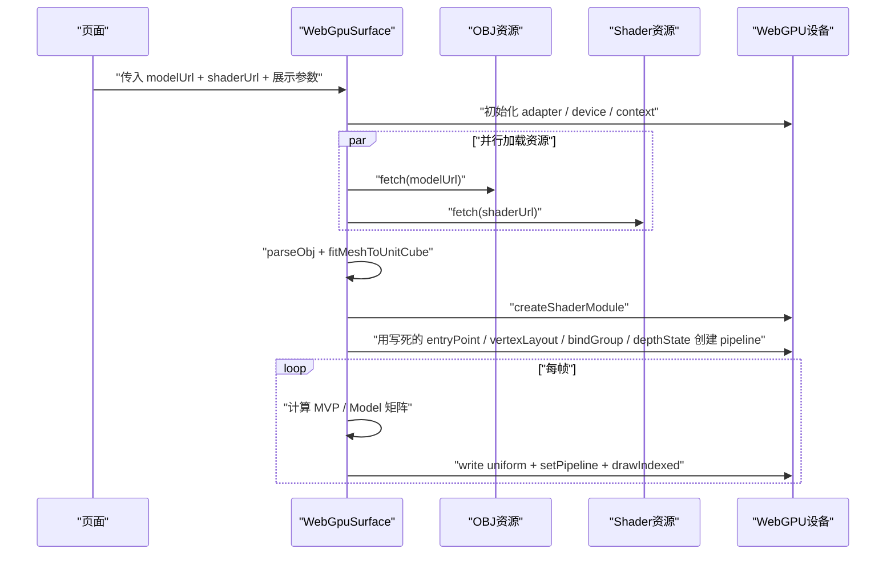
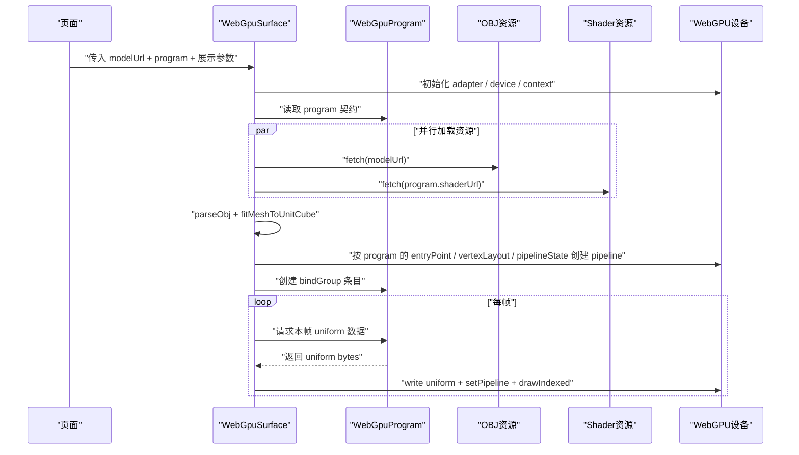

# WebGPU Program 抽象计划

## 目标与范围
- 目标：把当前写死在 [src/components/webgpu/webgpu-surface.tsx](src/components/webgpu/webgpu-surface.tsx) 里的 shader 契约、pipeline 契约和每帧 uniform 计算逻辑抽到独立 `program` 层。
- 本次改造后，[src/components/webgpu/webgpu-surface.tsx](src/components/webgpu/webgpu-surface.tsx) 只保留通用宿主能力：`canvas` 生命周期、`adapter/device/context` 初始化、`resize/depth texture` 管理、`render loop` 调度、通用错误与资源销毁。
- 本次会新增 `program` 类型与 `basic-lit` 的程序定义，预计新增文件：
  - [src/lib/webgpu/programs/types.ts](src/lib/webgpu/programs/types.ts)
  - [src/lib/webgpu/programs/basic-lit-program.ts](src/lib/webgpu/programs/basic-lit-program.ts)
- 本次会修改的入口文件：
  - [src/components/webgpu/webgpu-surface.tsx](src/components/webgpu/webgpu-surface.tsx)
  - [src/app/webgpu/page.tsx](src/app/webgpu/page.tsx)
- 本次明确不处理的范围：
  - [src/lib/loaders/obj-loader.ts](src/lib/loaders/obj-loader.ts) 的 `ObjMesh` 顶点格式通用化
  - `uv/tangent/material texture` 系统
  - 完整 `scene/material` 编排系统

## 改造前数据结构
- [src/components/webgpu/webgpu-surface.tsx](src/components/webgpu/webgpu-surface.tsx)
  - `WebGpuSurfaceProps`
    - `modelUrl: string`
    - `shaderUrl: string`
    - `ariaLabel?: string`
    - `cameraDistance?: number`
    - `rotationSpeedX?: number`
    - `rotationSpeedY?: number`
    - `backgroundColor?: string`
    - `clearColor?: { r; g; b; a? }`
    - `style?: CSSProperties`
  - 组件内部还隐式持有一整套 shader contract：
    - `vertexStride = 6 * f32`
    - `entryPoint = vsMain / fsMain`
    - `vertex layout = position(float32x3) + normal(float32x3)`
    - `uniformValues = Float32Array(32)`
    - `@group(0) @binding(0)` 的 bind group 结构
    - `primitive = triangle-list + back cull`
    - `depthStencil = depth24plus + less`
- [src/lib/loaders/obj-loader.ts](src/lib/loaders/obj-loader.ts)
  - `ObjMesh`
    - `vertices: Float32Array`
    - `indices: Uint16Array | Uint32Array`
  - 顶点打包格式是隐式约定：`[px, py, pz, nx, ny, nz]`
  - `fitMeshToUnitCube(vertices, stride = 6)` 默认也依赖这一顶点格式
- [public/shaders/basic-lit.wgsl](public/shaders/basic-lit.wgsl)
  - shader 文件虽然已经独立，但仍然被 TS 侧的固定 pipeline 描述强绑定
  - WGSL 与 TS 的耦合点仍散落在 `WebGpuSurface`

## 改造后数据结构
- [src/components/webgpu/webgpu-surface.tsx](src/components/webgpu/webgpu-surface.tsx)
  - `WebGpuSurfaceProps` 改为：
    - `modelUrl: string`
    - `program: WebGpuProgramDefinition`
    - `ariaLabel?: string`
    - `cameraDistance?: number`
    - `rotationSpeedX?: number`
    - `rotationSpeedY?: number`
    - `backgroundColor?: string`
    - `clearColor?: { r; g; b; a? }`
    - `style?: CSSProperties`
- [src/lib/webgpu/programs/types.ts](src/lib/webgpu/programs/types.ts)
  - 新增 `WebGpuProgramDefinition`，集中描述 shader 的 TS 侧契约。最小字段建议：
    - `label: string`
    - `shaderUrl: string`
    - `vertexEntryPoint: string`
    - `fragmentEntryPoint: string`
    - `vertexBufferLayouts: GPUVertexBufferLayout[]`
    - `uniformBufferByteLength: number`
    - `primitive: GPUPrimitiveState`
    - `depthStencil: GPUDepthStencilState`
    - `createBindGroupEntries(args): GPUBindGroupEntry[]`
    - `createFrameUniforms(args): Float32Array`
- [src/lib/webgpu/programs/basic-lit-program.ts](src/lib/webgpu/programs/basic-lit-program.ts)
  - 新增 `basicLitProgram`，把当前 `basic-lit.wgsl` 对应的：
    - shader 路径
    - `vsMain / fsMain`
    - `position + normal` 顶点布局
    - `128 bytes` 的 uniform 结构
    - `basic-lit` 每帧矩阵计算逻辑
    - bind group 条目定义
    统一收口到一个显式对象
- [src/lib/loaders/obj-loader.ts](src/lib/loaders/obj-loader.ts)
  - 本阶段保持不变，仍输出 `position + normal` 的 `ObjMesh`
  - 这意味着 program 抽象完成后，当前第一版仍然只支持与 `ObjMesh` 现有格式兼容的 program

## 改造前业务时序

## 改造后业务时序

## 改造步骤
1. 新建 [src/lib/webgpu/programs/types.ts](src/lib/webgpu/programs/types.ts)，定义最小可用 `WebGpuProgramDefinition`。
2. 新建 [src/lib/webgpu/programs/basic-lit-program.ts](src/lib/webgpu/programs/basic-lit-program.ts)，把当前 [public/shaders/basic-lit.wgsl](public/shaders/basic-lit.wgsl) 对应的 TS 契约迁移进去。
3. 修改 [src/components/webgpu/webgpu-surface.tsx](src/components/webgpu/webgpu-surface.tsx)：
   - `props` 从 `shaderUrl` 切换为 `program`
   - 用 `program.shaderUrl` 加载 shader
   - 用 `program.vertexEntryPoint / fragmentEntryPoint / vertexBufferLayouts / primitive / depthStencil` 创建 pipeline
   - 用 `program.uniformBufferByteLength` 分配 uniform buffer
   - 用 `program.createBindGroupEntries(...)` 创建 bind group
   - 用 `program.createFrameUniforms(...)` 生成每帧 uniform 数据
4. 修改 [src/app/webgpu/page.tsx](src/app/webgpu/page.tsx)，由页面选择 `basicLitProgram` 并传给 `WebGpuSurface`。
5. 保持 [src/lib/loaders/obj-loader.ts](src/lib/loaders/obj-loader.ts) 不动，验证当前 `ObjMesh` 能继续与 `basicLitProgram` 的顶点布局对齐。

## 验收标准
- [src/components/webgpu/webgpu-surface.tsx](src/components/webgpu/webgpu-surface.tsx) 中不再出现硬编码的：
  - `vsMain / fsMain`
  - 固定 `vertexBufferLayouts`
  - 固定 `uniformBuffer` 大小
  - 固定 bind group 条目定义
- [src/app/webgpu/page.tsx](src/app/webgpu/page.tsx) 改为传入 `program`，而不是直接传 `shaderUrl`
- 当前 `torus.obj + basic-lit.wgsl` 的渲染结果保持不变
- 通过 `lint`、`typecheck`、`build`

## 风险与边界
- 当前 `ObjMesh` 仍然是 `position + normal` 的固定格式，因此这一步完成后，系统只是把“shader contract”从 `surface` 中抽出，还不是“任意 mesh format + 任意 material”的完整通用系统。
- 如果下一阶段要支持 `uv`、`vertex color`、`tangent` 或纹理采样，再继续推进 `mesh format` 与 `material` 抽象即可；但这不应并入本次计划。